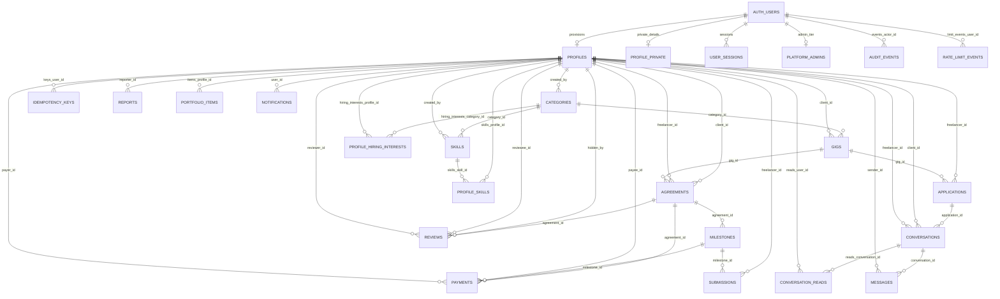

# Gigormoc database structure

Generated from the linked live Supabase catalog on 2026-10-13 by supabase/verification/generate_database_structure.ps1. Schema metadata only; no application rows were queried.

Live catalog: 27 public base tables, public routines, auth.users, and Storage buckets.

## Identity: auth.users

Supabase Auth identity records; application profile rows reference these identities. Authentication secrets and user data are not exported here, only column metadata.

| Column | Type | Nullable | Default |
|---|---|---:|---|
| `instance_id` | `uuid` | True | none |
| `id` | `uuid` | False | none |
| `aud` | `varchar` | True | none |
| `role` | `varchar` | True | none |
| `email` | `varchar` | True | none |
| `encrypted_password` | `varchar` | True | none |
| `email_confirmed_at` | `timestamptz` | True | none |
| `invited_at` | `timestamptz` | True | none |
| `confirmation_token` | `varchar` | True | none |
| `confirmation_sent_at` | `timestamptz` | True | none |
| `recovery_token` | `varchar` | True | none |
| `recovery_sent_at` | `timestamptz` | True | none |
| `email_change_token_new` | `varchar` | True | none |
| `email_change` | `varchar` | True | none |
| `email_change_sent_at` | `timestamptz` | True | none |
| `last_sign_in_at` | `timestamptz` | True | none |
| `raw_app_meta_data` | `jsonb` | True | none |
| `raw_user_meta_data` | `jsonb` | True | none |
| `is_super_admin` | `bool` | True | none |
| `created_at` | `timestamptz` | True | none |
| `updated_at` | `timestamptz` | True | none |
| `phone` | `text` | True | `NULL::character varying` |
| `phone_confirmed_at` | `timestamptz` | True | none |
| `phone_change` | `text` | True | `''::character varying` |
| `phone_change_token` | `varchar` | True | `''::character varying` |
| `phone_change_sent_at` | `timestamptz` | True | none |
| `confirmed_at` | `timestamptz` | True | none |
| `email_change_token_current` | `varchar` | True | `''::character varying` |
| `email_change_confirm_status` | `int2` | True | `0` |
| `banned_until` | `timestamptz` | True | none |
| `reauthentication_token` | `varchar` | True | `''::character varying` |
| `reauthentication_sent_at` | `timestamptz` | True | none |
| `is_sso_user` | `bool` | False | `false` |
| `deleted_at` | `timestamptz` | True | none |
| `is_anonymous` | `bool` | False | `false` |

## Public tables, constraints, indexes, and RLS

Columns, constraints, indexes, and policy expressions are read from the linked live catalog.

### `public.agreements`

Accepted gig work and agreed price.

| Column | Type | Nullable | Default |
|---|---|---:|---|
| `id` | `uuid` | False | `gen_random_uuid()` |
| `gig_id` | `uuid` | False | none |
| `client_id` | `uuid` | False | none |
| `freelancer_id` | `uuid` | False | none |
| `agreed_price` | `integer` | False | none |
| `deadline` | `timestamp with time zone` | False | none |
| `status` | `text` | False | `'active'::text` |
| `created_at` | `timestamp with time zone` | False | `now()` |
| `updated_at` | `timestamp with time zone` | False | `now()` |
| `completed_at` | `timestamp with time zone` | True | none |

Constraints:
- `agreements_agreed_price_check` - `CHECK (agreed_price > 0)`
- `agreements_client_id_fkey` - `FOREIGN KEY (client_id) REFERENCES profiles(id) ON DELETE RESTRICT`
- `agreements_freelancer_id_fkey` - `FOREIGN KEY (freelancer_id) REFERENCES profiles(id) ON DELETE RESTRICT`
- `agreements_gig_id_fkey` - `FOREIGN KEY (gig_id) REFERENCES gigs(id) ON DELETE RESTRICT`
- `agreements_pkey` - `PRIMARY KEY (id)`
- `agreements_status_check` - `CHECK (status = ANY (ARRAY['active'::text, 'completed'::text, 'cancelled'::text, 'disputed'::text]))`
- `chk_agreements_different_parties` - `CHECK (client_id <> freelancer_id)`

Indexes:
- `agreements_pkey` - `CREATE UNIQUE INDEX agreements_pkey ON public.agreements USING btree (id)`
- `idx_agreements_client_id` - `CREATE INDEX idx_agreements_client_id ON public.agreements USING btree (client_id)`
- `idx_agreements_freelancer_id` - `CREATE INDEX idx_agreements_freelancer_id ON public.agreements USING btree (freelancer_id)`
- `idx_agreements_status` - `CREATE INDEX idx_agreements_status ON public.agreements USING btree (status)`
- `idx_one_active_agreement_per_gig` - `CREATE UNIQUE INDEX idx_one_active_agreement_per_gig ON public.agreements USING btree (gig_id) WHERE (status = 'active'::text)`

RLS enabled: **True**; forced: **False**.
- `Participants can view agreement` (SELECT; roles: authenticated); USING: `((client_id = auth.uid()) OR (freelancer_id = auth.uid()) OR (EXISTS ( SELECT 1 FROM platform_admins WHERE (platform_admins.user_id = auth.uid()))))`

### `public.applications`

Freelancer proposals and counteroffers.

| Column | Type | Nullable | Default |
|---|---|---:|---|
| `id` | `uuid` | False | `gen_random_uuid()` |
| `gig_id` | `uuid` | False | none |
| `freelancer_id` | `uuid` | False | none |
| `proposed_price` | `integer` | False | none |
| `estimated_days` | `integer` | False | none |
| `message` | `text` | False | none |
| `status` | `text` | False | `'applied'::text` |
| `counter_price` | `integer` | True | none |
| `created_at` | `timestamp with time zone` | False | `now()` |
| `updated_at` | `timestamp with time zone` | False | `now()` |

Constraints:
- `applications_counter_price_check` - `CHECK (counter_price IS NULL OR counter_price > 0)`
- `applications_estimated_days_check` - `CHECK (estimated_days > 0)`
- `applications_freelancer_id_fkey` - `FOREIGN KEY (freelancer_id) REFERENCES profiles(id) ON DELETE CASCADE`
- `applications_gig_id_fkey` - `FOREIGN KEY (gig_id) REFERENCES gigs(id) ON DELETE CASCADE`
- `applications_gig_id_freelancer_id_key` - `UNIQUE (gig_id, freelancer_id)`
- `applications_pkey` - `PRIMARY KEY (id)`
- `applications_proposed_price_check` - `CHECK (proposed_price > 0)`
- `applications_status_check` - `CHECK (status = ANY (ARRAY['applied'::text, 'accepted'::text, 'declined'::text, 'countered'::text, 'withdrawn'::text]))`

Indexes:
- `applications_gig_id_freelancer_id_key` - `CREATE UNIQUE INDEX applications_gig_id_freelancer_id_key ON public.applications USING btree (gig_id, freelancer_id)`
- `applications_pkey` - `CREATE UNIQUE INDEX applications_pkey ON public.applications USING btree (id)`
- `idx_applications_freelancer_id` - `CREATE INDEX idx_applications_freelancer_id ON public.applications USING btree (freelancer_id)`
- `idx_applications_gig_id` - `CREATE INDEX idx_applications_gig_id ON public.applications USING btree (gig_id)`
- `idx_applications_status` - `CREATE INDEX idx_applications_status ON public.applications USING btree (status)`
- `idx_applications_unique_active_per_gig` - `CREATE UNIQUE INDEX idx_applications_unique_active_per_gig ON public.applications USING btree (gig_id, freelancer_id) WHERE (status = ANY (ARRAY['applied'::text, 'countered'::text, 'accepted'::text]))`

RLS enabled: **True**; forced: **False**.
- `Applicant can view own applications` (SELECT; roles: authenticated); USING: `((freelancer_id = auth.uid()) OR (EXISTS ( SELECT 1 FROM gigs WHERE ((gigs.id = applications.gig_id) AND (gigs.client_id = auth.uid())))))`

### `public.areas`

Admin-managed local area reference.

| Column | Type | Nullable | Default |
|---|---|---:|---|
| `id` | `uuid` | False | `gen_random_uuid()` |
| `name` | `text` | False | none |
| `is_active` | `boolean` | False | `true` |
| `created_at` | `timestamp with time zone` | False | `now()` |

Constraints:
- `areas_name_key` - `UNIQUE (name)`
- `areas_pkey` - `PRIMARY KEY (id)`

Indexes:
- `areas_name_key` - `CREATE UNIQUE INDEX areas_name_key ON public.areas USING btree (name)`
- `areas_pkey` - `CREATE UNIQUE INDEX areas_pkey ON public.areas USING btree (id)`

RLS enabled: **True**; forced: **False**.
- `Authenticated users can view active areas` (SELECT; roles: authenticated); USING: `(is_active = true)`

### `public.audit_events`

Append-only security and activity trail.

| Column | Type | Nullable | Default |
|---|---|---:|---|
| `id` | `uuid` | False | `gen_random_uuid()` |
| `actor_id` | `uuid` | True | none |
| `action` | `text` | True | none |
| `entity_type` | `text` | True | none |
| `entity_id` | `uuid` | True | none |
| `metadata` | `jsonb` | True | `'{}'::jsonb` |
| `created_at` | `timestamp with time zone` | False | `now()` |
| `event_type` | `text` | True | none |
| `target_id` | `uuid` | True | none |
| `target_table` | `text` | True | none |
| `actor_email` | `text` | True | none |
| `actor_role` | `text` | True | none |
| `status` | `text` | False | `'success'::text` |
| `ip` | `text` | True | none |
| `device` | `text` | True | none |

Constraints:
- `audit_events_actor_id_fkey` - `FOREIGN KEY (actor_id) REFERENCES auth.users(id) ON DELETE SET NULL`
- `audit_events_pkey` - `PRIMARY KEY (id)`
- `audit_events_status_check` - `CHECK (status = ANY (ARRAY['success'::text, 'failure'::text]))`

Indexes:
- `audit_events_actor_created_at_idx` - `CREATE INDEX audit_events_actor_created_at_idx ON public.audit_events USING btree (actor_id, created_at DESC)`
- `audit_events_created_at_idx` - `CREATE INDEX audit_events_created_at_idx ON public.audit_events USING btree (created_at DESC)`
- `audit_events_pkey` - `CREATE UNIQUE INDEX audit_events_pkey ON public.audit_events USING btree (id)`
- `audit_events_status_created_at_idx` - `CREATE INDEX audit_events_status_created_at_idx ON public.audit_events USING btree (status, created_at DESC)`

RLS enabled: **True**; forced: **False**.
No explicit client policy; access is default-deny under RLS.

### `public.categories`

Admin-managed gig categories.

| Column | Type | Nullable | Default |
|---|---|---:|---|
| `id` | `uuid` | False | `gen_random_uuid()` |
| `name` | `text` | False | none |
| `slug` | `text` | False | none |
| `is_active` | `boolean` | False | `true` |
| `created_at` | `timestamp with time zone` | False | `now()` |
| `source` | `text` | False | `'admin'::text` |
| `created_by` | `uuid` | True | none |

Constraints:
- `categories_created_by_fkey` - `FOREIGN KEY (created_by) REFERENCES profiles(id) ON DELETE SET NULL`
- `categories_pkey` - `PRIMARY KEY (id)`
- `categories_slug_key` - `UNIQUE (slug)`
- `categories_source_check` - `CHECK (source = ANY (ARRAY['admin'::text, 'user'::text]))`

Indexes:
- `categories_pkey` - `CREATE UNIQUE INDEX categories_pkey ON public.categories USING btree (id)`
- `categories_slug_key` - `CREATE UNIQUE INDEX categories_slug_key ON public.categories USING btree (slug)`
- `idx_categories_lower_name` - `CREATE UNIQUE INDEX idx_categories_lower_name ON public.categories USING btree (lower(TRIM(BOTH FROM name)))`
- `idx_categories_trgm_name` - `CREATE INDEX idx_categories_trgm_name ON public.categories USING gin (lower(name) gin_trgm_ops)`

RLS enabled: **True**; forced: **False**.
- `Authenticated users can view active or own categories` (SELECT; roles: authenticated); USING: `((is_active = true) OR (created_by = auth.uid()))`
- `Platform admins can delete categories` (DELETE; roles: authenticated); USING: `(EXISTS ( SELECT 1 FROM platform_admins WHERE (platform_admins.user_id = auth.uid())))`
- `Platform admins can insert categories` (INSERT; roles: authenticated); WITH CHECK: `(EXISTS ( SELECT 1 FROM platform_admins WHERE (platform_admins.user_id = auth.uid())))`
- `Platform admins can update categories` (UPDATE; roles: authenticated); USING: `(EXISTS ( SELECT 1 FROM platform_admins WHERE (platform_admins.user_id = auth.uid())))`; WITH CHECK: `(EXISTS ( SELECT 1 FROM platform_admins WHERE (platform_admins.user_id = auth.uid())))`

### `public.conversation_reads`

Per-user conversation read position.

| Column | Type | Nullable | Default |
|---|---|---:|---|
| `conversation_id` | `uuid` | False | none |
| `user_id` | `uuid` | False | none |
| `last_read_at` | `timestamp with time zone` | False | `now()` |

Constraints:
- `conversation_reads_conversation_id_fkey` - `FOREIGN KEY (conversation_id) REFERENCES conversations(id) ON DELETE CASCADE`
- `conversation_reads_pkey` - `PRIMARY KEY (conversation_id, user_id)`
- `conversation_reads_user_id_fkey` - `FOREIGN KEY (user_id) REFERENCES profiles(id) ON DELETE CASCADE`

Indexes:
- `conversation_reads_pkey` - `CREATE UNIQUE INDEX conversation_reads_pkey ON public.conversation_reads USING btree (conversation_id, user_id)`
- `idx_conversation_reads_user` - `CREATE INDEX idx_conversation_reads_user ON public.conversation_reads USING btree (user_id)`

RLS enabled: **True**; forced: **False**.
- `Users can manage own conversation reads` (ALL; roles: authenticated); USING: `(user_id = auth.uid())`; WITH CHECK: `(user_id = auth.uid())`

### `public.conversations`

Message thread and participant link.

| Column | Type | Nullable | Default |
|---|---|---:|---|
| `id` | `uuid` | False | `gen_random_uuid()` |
| `application_id` | `uuid` | False | none |
| `client_id` | `uuid` | False | none |
| `freelancer_id` | `uuid` | False | none |
| `created_at` | `timestamp with time zone` | False | `now()` |
| `updated_at` | `timestamp with time zone` | False | `now()` |

Constraints:
- `conversations_application_id_fkey` - `FOREIGN KEY (application_id) REFERENCES applications(id) ON DELETE CASCADE`
- `conversations_application_id_key` - `UNIQUE (application_id)`
- `conversations_client_id_fkey` - `FOREIGN KEY (client_id) REFERENCES profiles(id) ON DELETE CASCADE`
- `conversations_freelancer_id_fkey` - `FOREIGN KEY (freelancer_id) REFERENCES profiles(id) ON DELETE CASCADE`
- `conversations_pkey` - `PRIMARY KEY (id)`

Indexes:
- `conversations_application_id_key` - `CREATE UNIQUE INDEX conversations_application_id_key ON public.conversations USING btree (application_id)`
- `conversations_pkey` - `CREATE UNIQUE INDEX conversations_pkey ON public.conversations USING btree (id)`
- `idx_conversations_client_id` - `CREATE INDEX idx_conversations_client_id ON public.conversations USING btree (client_id)`
- `idx_conversations_freelancer_id` - `CREATE INDEX idx_conversations_freelancer_id ON public.conversations USING btree (freelancer_id)`

RLS enabled: **True**; forced: **False**.
- `Participants read conversations` (SELECT; roles: authenticated); USING: `((client_id = auth.uid()) OR (freelancer_id = auth.uid()) OR (EXISTS ( SELECT 1 FROM platform_admins WHERE (platform_admins.user_id = auth.uid()))))`

### `public.gigs`

Client-posted work.

| Column | Type | Nullable | Default |
|---|---|---:|---|
| `id` | `uuid` | False | `gen_random_uuid()` |
| `client_id` | `uuid` | False | none |
| `title` | `text` | False | none |
| `description` | `text` | False | none |
| `requirements` | `text` | False | `''::text` |
| `category_id` | `uuid` | False | none |
| `price_min` | `integer` | False | none |
| `price_max` | `integer` | False | none |
| `work_type` | `text` | False | none |
| `area` | `text` | True | `''::text` |
| `application_deadline` | `timestamp with time zone` | False | none |
| `deadline` | `timestamp with time zone` | False | none |
| `status` | `text` | False | `'draft'::text` |
| `created_at` | `timestamp with time zone` | False | `now()` |
| `updated_at` | `timestamp with time zone` | False | `now()` |

Constraints:
- `gigs_category_id_fkey` - `FOREIGN KEY (category_id) REFERENCES categories(id) ON DELETE RESTRICT`
- `gigs_check` - `CHECK (price_max >= price_min)`
- `gigs_client_id_fkey` - `FOREIGN KEY (client_id) REFERENCES profiles(id) ON DELETE CASCADE`
- `gigs_pkey` - `PRIMARY KEY (id)`
- `gigs_price_min_check` - `CHECK (price_min >= 0)`
- `gigs_status_check` - `CHECK (status = ANY (ARRAY['draft'::text, 'open'::text, 'in_progress'::text, 'completed'::text, 'cancelled'::text, 'expired'::text]))`
- `gigs_work_type_check` - `CHECK (work_type = ANY (ARRAY['remote'::text, 'face_to_face'::text, 'hybrid'::text]))`

Indexes:
- `gigs_pkey` - `CREATE UNIQUE INDEX gigs_pkey ON public.gigs USING btree (id)`
- `idx_gigs_category_id` - `CREATE INDEX idx_gigs_category_id ON public.gigs USING btree (category_id)`
- `idx_gigs_client_id` - `CREATE INDEX idx_gigs_client_id ON public.gigs USING btree (client_id)`
- `idx_gigs_created_at` - `CREATE INDEX idx_gigs_created_at ON public.gigs USING btree (created_at DESC)`
- `idx_gigs_status` - `CREATE INDEX idx_gigs_status ON public.gigs USING btree (status)`
- `idx_gigs_work_type` - `CREATE INDEX idx_gigs_work_type ON public.gigs USING btree (work_type)`

RLS enabled: **True**; forced: **False**.
- `Anyone can view open gigs` (SELECT; roles: authenticated); USING: `((status = 'open'::text) OR (client_id = auth.uid()))`
- `Clients can delete own draft gigs` (DELETE; roles: authenticated); USING: `((client_id = auth.uid()) AND (status = 'draft'::text))`
- `Clients can insert own draft gigs` (INSERT; roles: authenticated); WITH CHECK: `((client_id = auth.uid()) AND (status = 'draft'::text))`
- `Clients can update own draft gigs` (UPDATE; roles: authenticated); USING: `((client_id = auth.uid()) AND (status = 'draft'::text))`; WITH CHECK: `((client_id = auth.uid()) AND (status = 'draft'::text))`

### `public.idempotency_keys`

Request keys preventing duplicate writes.

| Column | Type | Nullable | Default |
|---|---|---:|---|
| `user_id` | `uuid` | False | none |
| `request_id` | `uuid` | False | none |
| `rpc_name` | `text` | False | none |
| `result` | `jsonb` | False | `'null'::jsonb` |
| `created_at` | `timestamp with time zone` | False | `now()` |

Constraints:
- `idempotency_keys_pkey` - `PRIMARY KEY (user_id, request_id)`
- `idempotency_keys_user_id_fkey` - `FOREIGN KEY (user_id) REFERENCES profiles(id) ON DELETE CASCADE`

Indexes:
- `idempotency_keys_pkey` - `CREATE UNIQUE INDEX idempotency_keys_pkey ON public.idempotency_keys USING btree (user_id, request_id)`
- `idx_idempotency_keys_created_at` - `CREATE INDEX idx_idempotency_keys_created_at ON public.idempotency_keys USING btree (created_at)`

RLS enabled: **True**; forced: **False**.
No explicit client policy; access is default-deny under RLS.

### `public.login_attempts`

Per-email failed-login counters.

| Column | Type | Nullable | Default |
|---|---|---:|---|
| `email_normalized` | `text` | False | none |
| `failed_count` | `integer` | False | `0` |
| `lock_level` | `integer` | False | `0` |
| `locked_until` | `timestamp with time zone` | True | none |
| `last_failed_at` | `timestamp with time zone` | True | none |
| `last_ip` | `text` | True | none |
| `updated_at` | `timestamp with time zone` | False | `now()` |

Constraints:
- `login_attempts_email_normalized_check` - `CHECK (email_normalized = lower(btrim(email_normalized)) AND length(email_normalized) >= 3 AND length(email_normalized) <= 320)`
- `login_attempts_failed_count_check` - `CHECK (failed_count >= 0 AND failed_count <= 2)`
- `login_attempts_last_ip_check` - `CHECK (last_ip IS NULL OR length(last_ip) <= 64)`
- `login_attempts_lock_level_check` - `CHECK (lock_level >= 0 AND lock_level <= 5)`
- `login_attempts_pkey` - `PRIMARY KEY (email_normalized)`

Indexes:
- `login_attempts_pkey` - `CREATE UNIQUE INDEX login_attempts_pkey ON public.login_attempts USING btree (email_normalized)`

RLS enabled: **True**; forced: **False**.
No explicit client policy; access is default-deny under RLS.

### `public.login_ip_attempts`

Per-IP failed-login counters.

| Column | Type | Nullable | Default |
|---|---|---:|---|
| `ip_normalized` | `text` | False | none |
| `failed_count` | `integer` | False | `0` |
| `lock_level` | `integer` | False | `0` |
| `locked_until` | `timestamp with time zone` | True | none |
| `last_failed_at` | `timestamp with time zone` | True | none |
| `updated_at` | `timestamp with time zone` | False | `now()` |

Constraints:
- `login_ip_attempts_failed_count_check` - `CHECK (failed_count >= 0 AND failed_count <= 9)`
- `login_ip_attempts_ip_normalized_check` - `CHECK (length(ip_normalized) >= 2 AND length(ip_normalized) <= 64)`
- `login_ip_attempts_lock_level_check` - `CHECK (lock_level >= 0 AND lock_level <= 5)`
- `login_ip_attempts_pkey` - `PRIMARY KEY (ip_normalized)`

Indexes:
- `login_ip_attempts_pkey` - `CREATE UNIQUE INDEX login_ip_attempts_pkey ON public.login_ip_attempts USING btree (ip_normalized)`

RLS enabled: **True**; forced: **False**.
No explicit client policy; access is default-deny under RLS.

### `public.messages`

Conversation messages.

| Column | Type | Nullable | Default |
|---|---|---:|---|
| `id` | `uuid` | False | `gen_random_uuid()` |
| `conversation_id` | `uuid` | False | none |
| `sender_id` | `uuid` | False | none |
| `content` | `text` | False | none |
| `created_at` | `timestamp with time zone` | False | `now()` |

Constraints:
- `messages_content_check` - `CHECK (char_length(TRIM(BOTH FROM content)) >= 1 AND char_length(TRIM(BOTH FROM content)) <= 2000)`
- `messages_conversation_id_fkey` - `FOREIGN KEY (conversation_id) REFERENCES conversations(id) ON DELETE CASCADE`
- `messages_pkey` - `PRIMARY KEY (id)`
- `messages_sender_id_fkey` - `FOREIGN KEY (sender_id) REFERENCES profiles(id) ON DELETE CASCADE`

Indexes:
- `idx_messages_conversation_id` - `CREATE INDEX idx_messages_conversation_id ON public.messages USING btree (conversation_id)`
- `idx_messages_created_at` - `CREATE INDEX idx_messages_created_at ON public.messages USING btree (created_at)`
- `messages_pkey` - `CREATE UNIQUE INDEX messages_pkey ON public.messages USING btree (id)`

RLS enabled: **True**; forced: **False**.
- `Participants read messages` (SELECT; roles: authenticated); USING: `(EXISTS ( SELECT 1 FROM conversations c WHERE ((c.id = messages.conversation_id) AND ((c.client_id = auth.uid()) OR (c.freelancer_id = auth.uid()) OR (EXISTS ( SELECT 1 FROM platform_admins WHERE (platform_admins.user_id = auth.uid())))))))`

### `public.milestones`

Agreed work stages, amounts, and review state.

| Column | Type | Nullable | Default |
|---|---|---:|---|
| `id` | `uuid` | False | `gen_random_uuid()` |
| `agreement_id` | `uuid` | False | none |
| `seq` | `integer` | False | none |
| `title` | `text` | False | none |
| `description` | `text` | False | `''::text` |
| `amount` | `integer` | False | none |
| `status` | `text` | False | `'pending'::text` |
| `revision_count` | `integer` | False | `0` |
| `created_at` | `timestamp with time zone` | False | `now()` |
| `updated_at` | `timestamp with time zone` | False | `now()` |
| `position` | `integer` | True | none |

Constraints:
- `milestones_agreement_id_fkey` - `FOREIGN KEY (agreement_id) REFERENCES agreements(id) ON DELETE CASCADE`
- `milestones_agreement_id_seq_key` - `UNIQUE (agreement_id, seq)`
- `milestones_amount_check` - `CHECK (amount > 0)`
- `milestones_description_check` - `CHECK (char_length(description) <= 1000)`
- `milestones_pkey` - `PRIMARY KEY (id)`
- `milestones_revision_count_check` - `CHECK (revision_count >= 0 AND revision_count <= 2)`
- `milestones_seq_check` - `CHECK (seq >= 1 AND seq <= 5)`
- `milestones_status_check` - `CHECK (status = ANY (ARRAY['pending'::text, 'submitted'::text, 'approved'::text, 'revision_requested'::text]))`
- `milestones_title_check` - `CHECK (char_length(title) >= 3 AND char_length(title) <= 120)`

Indexes:
- `idx_milestones_agreement_id` - `CREATE INDEX idx_milestones_agreement_id ON public.milestones USING btree (agreement_id)`
- `milestones_agreement_id_seq_key` - `CREATE UNIQUE INDEX milestones_agreement_id_seq_key ON public.milestones USING btree (agreement_id, seq)`
- `milestones_pkey` - `CREATE UNIQUE INDEX milestones_pkey ON public.milestones USING btree (id)`

RLS enabled: **True**; forced: **False**.
- `Participants read agreement milestones` (SELECT; roles: authenticated); USING: `(EXISTS ( SELECT 1 FROM agreements a WHERE ((a.id = milestones.agreement_id) AND ((a.client_id = auth.uid()) OR (a.freelancer_id = auth.uid()) OR (EXISTS ( SELECT 1 FROM platform_admins WHERE (platform_admins.user_id = auth.uid())))))))`

### `public.notifications`

In-app notifications by recipient.

| Column | Type | Nullable | Default |
|---|---|---:|---|
| `id` | `uuid` | False | `gen_random_uuid()` |
| `user_id` | `uuid` | False | none |
| `type` | `text` | False | none |
| `title` | `text` | False | none |
| `body` | `text` | False | none |
| `entity_type` | `text` | True | none |
| `entity_id` | `uuid` | True | none |
| `data` | `jsonb` | True | `'{}'::jsonb` |
| `read_at` | `timestamp with time zone` | True | none |
| `created_at` | `timestamp with time zone` | False | `now()` |
| `dedupe_key` | `text` | True | none |

Constraints:
- `notifications_pkey` - `PRIMARY KEY (id)`
- `notifications_user_id_fkey` - `FOREIGN KEY (user_id) REFERENCES profiles(id) ON DELETE CASCADE`

Indexes:
- `idx_notifications_profile_complete_once` - `CREATE UNIQUE INDEX idx_notifications_profile_complete_once ON public.notifications USING btree (user_id) WHERE (type = 'profile_complete'::text)`
- `idx_notifications_user_created` - `CREATE INDEX idx_notifications_user_created ON public.notifications USING btree (user_id, created_at DESC)`
- `idx_notifications_user_dedupe_key` - `CREATE UNIQUE INDEX idx_notifications_user_dedupe_key ON public.notifications USING btree (user_id, dedupe_key) WHERE (dedupe_key IS NOT NULL)`
- `idx_notifications_user_unread` - `CREATE INDEX idx_notifications_user_unread ON public.notifications USING btree (user_id) WHERE (read_at IS NULL)`
- `notifications_pkey` - `CREATE UNIQUE INDEX notifications_pkey ON public.notifications USING btree (id)`

RLS enabled: **True**; forced: **False**.
- `Users can view own notifications` (SELECT; roles: authenticated); USING: `(user_id = auth.uid())`

### `public.payments`

External payment reports; the marketplace does not hold funds.

| Column | Type | Nullable | Default |
|---|---|---:|---|
| `id` | `uuid` | False | `gen_random_uuid()` |
| `agreement_id` | `uuid` | False | none |
| `milestone_id` | `uuid` | True | none |
| `payer_id` | `uuid` | False | none |
| `payee_id` | `uuid` | False | none |
| `amount` | `integer` | False | none |
| `payment_method` | `text` | False | none |
| `reference_number` | `text` | False | `''::text` |
| `receipt_path` | `text` | True | none |
| `notes` | `text` | False | `''::text` |
| `status` | `text` | False | `'reported_sent'::text` |
| `dispute_reason` | `text` | True | none |
| `reported_at` | `timestamp with time zone` | False | `now()` |
| `confirmed_at` | `timestamp with time zone` | True | none |
| `disputed_at` | `timestamp with time zone` | True | none |
| `created_at` | `timestamp with time zone` | False | `now()` |
| `updated_at` | `timestamp with time zone` | False | `now()` |

Constraints:
- `payments_agreement_id_fkey` - `FOREIGN KEY (agreement_id) REFERENCES agreements(id) ON DELETE CASCADE`
- `payments_amount_check` - `CHECK (amount > 0)`
- `payments_dispute_reason_check` - `CHECK (dispute_reason IS NULL OR char_length(dispute_reason) >= 5 AND char_length(dispute_reason) <= 1000)`
- `payments_milestone_id_fkey` - `FOREIGN KEY (milestone_id) REFERENCES milestones(id) ON DELETE SET NULL`
- `payments_notes_check` - `CHECK (char_length(notes) <= 1000)`
- `payments_payee_id_fkey` - `FOREIGN KEY (payee_id) REFERENCES profiles(id) ON DELETE CASCADE`
- `payments_payer_id_fkey` - `FOREIGN KEY (payer_id) REFERENCES profiles(id) ON DELETE CASCADE`
- `payments_payment_method_check` - `CHECK (payment_method = ANY (ARRAY['gcash'::text, 'maya'::text, 'bank_transfer'::text, 'cash'::text, 'other'::text]))`
- `payments_pkey` - `PRIMARY KEY (id)`
- `payments_reference_number_check` - `CHECK (char_length(reference_number) <= 100)`
- `payments_status_check` - `CHECK (status = ANY (ARRAY['reported_sent'::text, 'confirmed_received'::text, 'disputed'::text]))`

Indexes:
- `idx_payments_agreement_id` - `CREATE INDEX idx_payments_agreement_id ON public.payments USING btree (agreement_id)`
- `idx_payments_payee_id` - `CREATE INDEX idx_payments_payee_id ON public.payments USING btree (payee_id)`
- `idx_payments_payer_id` - `CREATE INDEX idx_payments_payer_id ON public.payments USING btree (payer_id)`
- `idx_payments_unique_open_per_milestone` - `CREATE UNIQUE INDEX idx_payments_unique_open_per_milestone ON public.payments USING btree (agreement_id, COALESCE(milestone_id, '00000000-0000-0000-0000-000000000000'::uuid)) WHERE (status = ANY (ARRAY['reported_sent'::text, 'confirmed_received'::text]))`
- `payments_pkey` - `CREATE UNIQUE INDEX payments_pkey ON public.payments USING btree (id)`

RLS enabled: **True**; forced: **False**.
- `Participants read agreement payments` (SELECT; roles: authenticated); USING: `((payer_id = auth.uid()) OR (payee_id = auth.uid()) OR (EXISTS ( SELECT 1 FROM platform_admins WHERE (platform_admins.user_id = auth.uid()))))`

### `public.platform_admins`

Admin allow-list and privilege tier.

| Column | Type | Nullable | Default |
|---|---|---:|---|
| `user_id` | `uuid` | False | none |
| `created_at` | `timestamp with time zone` | False | `now()` |
| `role` | `text` | False | `'admin'::text` |

Constraints:
- `platform_admins_pkey` - `PRIMARY KEY (user_id)`
- `platform_admins_role_check` - `CHECK (role = ANY (ARRAY['admin'::text, 'super_admin'::text]))`
- `platform_admins_user_id_fkey` - `FOREIGN KEY (user_id) REFERENCES auth.users(id) ON DELETE CASCADE`

Indexes:
- `platform_admins_pkey` - `CREATE UNIQUE INDEX platform_admins_pkey ON public.platform_admins USING btree (user_id)`

RLS enabled: **True**; forced: **False**.
No explicit client policy; access is default-deny under RLS.

### `public.portfolio_items`

Freelancer portfolio entries and media paths.

| Column | Type | Nullable | Default |
|---|---|---:|---|
| `id` | `uuid` | False | `gen_random_uuid()` |
| `profile_id` | `uuid` | False | none |
| `title` | `text` | False | none |
| `description` | `text` | True | `''::text` |
| `file_paths` | `text[]` | False | `'{}'::text[]` |
| `created_at` | `timestamp with time zone` | False | `now()` |

Constraints:
- `portfolio_items_pkey` - `PRIMARY KEY (id)`
- `portfolio_items_profile_id_fkey` - `FOREIGN KEY (profile_id) REFERENCES profiles(id) ON DELETE CASCADE`

Indexes:
- `portfolio_items_pkey` - `CREATE UNIQUE INDEX portfolio_items_pkey ON public.portfolio_items USING btree (id)`

RLS enabled: **True**; forced: **False**.
- `Authenticated users can view portfolio items` (SELECT; roles: authenticated); USING: `true`
- `Users can delete own portfolio items` (DELETE; roles: authenticated); USING: `(profile_id = auth.uid())`
- `Users can insert own portfolio items` (INSERT; roles: authenticated); WITH CHECK: `(profile_id = auth.uid())`
- `Users can update own portfolio items` (UPDATE; roles: authenticated); USING: `(profile_id = auth.uid())`; WITH CHECK: `(profile_id = auth.uid())`

### `public.profile_hiring_interests`

Client hiring interests.

| Column | Type | Nullable | Default |
|---|---|---:|---|
| `profile_id` | `uuid` | False | none |
| `category_id` | `uuid` | False | none |
| `created_at` | `timestamp with time zone` | False | `now()` |

Constraints:
- `profile_hiring_interests_category_id_fkey` - `FOREIGN KEY (category_id) REFERENCES categories(id) ON DELETE CASCADE`
- `profile_hiring_interests_pkey` - `PRIMARY KEY (profile_id, category_id)`
- `profile_hiring_interests_profile_id_fkey` - `FOREIGN KEY (profile_id) REFERENCES profiles(id) ON DELETE CASCADE`

Indexes:
- `profile_hiring_interests_pkey` - `CREATE UNIQUE INDEX profile_hiring_interests_pkey ON public.profile_hiring_interests USING btree (profile_id, category_id)`

RLS enabled: **True**; forced: **False**.
- `Authenticated users can view hiring interests` (SELECT; roles: authenticated); USING: `true`

### `public.profile_private`

Private age and contact details.

| Column | Type | Nullable | Default |
|---|---|---:|---|
| `user_id` | `uuid` | False | none |
| `dob` | `date` | False | none |
| `phone` | `text` | True | none |
| `terms_version` | `text` | False | `'v1.0'::text` |
| `terms_accepted_at` | `timestamp with time zone` | False | `now()` |

Constraints:
- `profile_private_pkey` - `PRIMARY KEY (user_id)`
- `profile_private_user_id_fkey` - `FOREIGN KEY (user_id) REFERENCES auth.users(id) ON DELETE CASCADE`

Indexes:
- `profile_private_pkey` - `CREATE UNIQUE INDEX profile_private_pkey ON public.profile_private USING btree (user_id)`

RLS enabled: **True**; forced: **False**.
- `Owner can view own private profile` (SELECT; roles: authenticated); USING: `(auth.uid() = user_id)`

### `public.profile_skills`

Freelancer-to-skill links.

| Column | Type | Nullable | Default |
|---|---|---:|---|
| `profile_id` | `uuid` | False | none |
| `skill_id` | `uuid` | False | none |
| `created_at` | `timestamp with time zone` | False | `now()` |

Constraints:
- `profile_skills_pkey` - `PRIMARY KEY (profile_id, skill_id)`
- `profile_skills_profile_id_fkey` - `FOREIGN KEY (profile_id) REFERENCES profiles(id) ON DELETE CASCADE`
- `profile_skills_skill_id_fkey` - `FOREIGN KEY (skill_id) REFERENCES skills(id) ON DELETE CASCADE`

Indexes:
- `profile_skills_pkey` - `CREATE UNIQUE INDEX profile_skills_pkey ON public.profile_skills USING btree (profile_id, skill_id)`

RLS enabled: **True**; forced: **False**.
- `Authenticated users can view profile skills` (SELECT; roles: authenticated); USING: `true`
- `Users can add own skills` (INSERT; roles: authenticated); WITH CHECK: `(profile_id = auth.uid())`
- `Users can remove own skills` (DELETE; roles: authenticated); USING: `(profile_id = auth.uid())`

### `public.profiles`

Public profile, mode, account status, and role-specific ratings.

| Column | Type | Nullable | Default |
|---|---|---:|---|
| `id` | `uuid` | False | none |
| `display_name` | `text` | False | `''::text` |
| `bio` | `text` | True | `''::text` |
| `avatar_path` | `text` | True | none |
| `area` | `text` | True | `''::text` |
| `onboarding_complete` | `boolean` | False | `false` |
| `status` | `text` | False | `'active'::text` |
| `created_at` | `timestamp with time zone` | False | `now()` |
| `active_mode` | `text` | True | none |
| `mode_changed_at` | `timestamp with time zone` | True | none |
| `freelancer_rating_avg` | `numeric` | False | `0.00` |
| `freelancer_rating_count` | `integer` | False | `0` |
| `client_rating_avg` | `numeric` | False | `0.00` |
| `client_rating_count` | `integer` | False | `0` |
| `freelancer_completed_gigs` | `integer` | False | `0` |
| `client_completed_gigs` | `integer` | False | `0` |
| `updated_at` | `timestamp with time zone` | False | `now()` |
| `headline` | `text` | False | `''::text` |
| `preferred_contact` | `text` | False | `'In-app chat'::text` |
| `languages` | `text[]` | False | `ARRAY[]::text[]` |
| `work_types` | `text[]` | False | `ARRAY[]::text[]` |
| `availability` | `text` | True | none |
| `experience_years` | `text` | True | none |
| `starting_rate_note` | `text` | False | `''::text` |
| `client_type` | `text` | True | none |
| `business_name` | `text` | False | `''::text` |
| `about_hiring` | `text` | False | `''::text` |
| `must_change_password` | `boolean` | False | `false` |

Constraints:
- `profiles_active_mode_check` - `CHECK (active_mode = ANY (ARRAY['find_work'::text, 'hire'::text]))`
- `profiles_availability_chk` - `CHECK (availability IS NULL OR (availability = ANY (ARRAY['available_now'::text, 'part_time'::text, 'weekends'::text, 'not_taking_work'::text])))`
- `profiles_client_type_chk` - `CHECK (client_type IS NULL OR (client_type = ANY (ARRAY['individual'::text, 'business'::text, 'organization'::text, 'other'::text])))`
- `profiles_experience_years_chk` - `CHECK (experience_years IS NULL OR (experience_years = ANY (ARRAY['lt_1'::text, '1_3'::text, '3_5'::text, '5_plus'::text])))`
- `profiles_headline_len_chk` - `CHECK (char_length(headline) <= 80)`
- `profiles_id_fkey` - `FOREIGN KEY (id) REFERENCES auth.users(id) ON DELETE CASCADE`
- `profiles_pkey` - `PRIMARY KEY (id)`
- `profiles_status_check` - `CHECK (status = ANY (ARRAY['active'::text, 'suspended'::text, 'deactivated'::text, 'deleted'::text]))`

Indexes:
- `profiles_pkey` - `CREATE UNIQUE INDEX profiles_pkey ON public.profiles USING btree (id)`

RLS enabled: **True**; forced: **False**.
- `Authenticated users can view active profiles` (SELECT; roles: authenticated); USING: `((status = 'active'::text) OR (auth.uid() = id))`
- `Users can update own safe profile columns` (UPDATE; roles: authenticated); USING: `(auth.uid() = id)`; WITH CHECK: `(auth.uid() = id)`

### `public.rate_limit_events`

Database-backed action rate limits.

| Column | Type | Nullable | Default |
|---|---|---:|---|
| `id` | `uuid` | False | `gen_random_uuid()` |
| `user_id` | `uuid` | False | none |
| `action` | `text` | False | none |
| `created_at` | `timestamp with time zone` | False | `now()` |

Constraints:
- `rate_limit_events_pkey` - `PRIMARY KEY (id)`
- `rate_limit_events_user_id_fkey` - `FOREIGN KEY (user_id) REFERENCES auth.users(id) ON DELETE CASCADE`

Indexes:
- `idx_rate_limit_events` - `CREATE INDEX idx_rate_limit_events ON public.rate_limit_events USING btree (user_id, action, created_at DESC)`
- `rate_limit_events_pkey` - `CREATE UNIQUE INDEX rate_limit_events_pkey ON public.rate_limit_events USING btree (id)`

RLS enabled: **True**; forced: **False**.
No explicit client policy; access is default-deny under RLS.

### `public.reports`

User-submitted moderation reports.

| Column | Type | Nullable | Default |
|---|---|---:|---|
| `id` | `uuid` | False | `gen_random_uuid()` |
| `reporter_id` | `uuid` | False | none |
| `target_type` | `text` | False | none |
| `target_id` | `uuid` | False | none |
| `reason_category` | `text` | False | none |
| `details` | `text` | False | none |
| `evidence_path` | `text` | True | none |
| `status` | `text` | False | `'pending'::text` |
| `resolution_notes` | `text` | True | none |
| `created_at` | `timestamp with time zone` | False | `now()` |
| `resolved_at` | `timestamp with time zone` | True | none |

Constraints:
- `reports_details_check` - `CHECK (char_length(TRIM(BOTH FROM details)) >= 10 AND char_length(TRIM(BOTH FROM details)) <= 2000)`
- `reports_pkey` - `PRIMARY KEY (id)`
- `reports_reason_category_check` - `CHECK (reason_category = ANY (ARRAY['spam_scam'::text, 'harassment'::text, 'unresponsive'::text, 'payment_issue'::text, 'work_quality'::text, 'cancellation_request'::text, 'other'::text]))`
- `reports_reporter_id_fkey` - `FOREIGN KEY (reporter_id) REFERENCES profiles(id) ON DELETE CASCADE`
- `reports_status_check` - `CHECK (status = ANY (ARRAY['pending'::text, 'reviewed'::text, 'dismissed'::text, 'action_taken'::text]))`
- `reports_target_type_check` - `CHECK (target_type = ANY (ARRAY['profile'::text, 'gig'::text, 'agreement'::text, 'message'::text]))`

Indexes:
- `idx_reports_reporter_id` - `CREATE INDEX idx_reports_reporter_id ON public.reports USING btree (reporter_id)`
- `idx_reports_status` - `CREATE INDEX idx_reports_status ON public.reports USING btree (status)`
- `reports_pkey` - `CREATE UNIQUE INDEX reports_pkey ON public.reports USING btree (id)`

RLS enabled: **True**; forced: **False**.
- `Reporter reads own reports` (SELECT; roles: authenticated); USING: `((reporter_id = auth.uid()) OR (EXISTS ( SELECT 1 FROM platform_admins WHERE (platform_admins.user_id = auth.uid()))))`

### `public.reviews`

Agreement participant reviews and moderation state.

| Column | Type | Nullable | Default |
|---|---|---:|---|
| `id` | `uuid` | False | `gen_random_uuid()` |
| `agreement_id` | `uuid` | False | none |
| `reviewer_id` | `uuid` | False | none |
| `reviewee_id` | `uuid` | False | none |
| `role` | `text` | False | none |
| `rating` | `integer` | False | none |
| `comment` | `text` | False | none |
| `created_at` | `timestamp with time zone` | False | `now()` |
| `reviewee_role` | `text` | True | none |
| `hidden` | `boolean` | False | `false` |
| `hidden_at` | `timestamp with time zone` | True | none |
| `hidden_by` | `uuid` | True | none |

Constraints:
- `reviews_agreement_id_fkey` - `FOREIGN KEY (agreement_id) REFERENCES agreements(id) ON DELETE CASCADE`
- `reviews_agreement_id_reviewer_id_key` - `UNIQUE (agreement_id, reviewer_id)`
- `reviews_comment_check` - `CHECK (char_length(comment) >= 10 AND char_length(comment) <= 1000)`
- `reviews_hidden_by_fkey` - `FOREIGN KEY (hidden_by) REFERENCES profiles(id)`
- `reviews_pkey` - `PRIMARY KEY (id)`
- `reviews_rating_check` - `CHECK (rating >= 1 AND rating <= 5)`
- `reviews_reviewee_id_fkey` - `FOREIGN KEY (reviewee_id) REFERENCES profiles(id) ON DELETE CASCADE`
- `reviews_reviewee_role_check` - `CHECK (reviewee_role = ANY (ARRAY['freelancer'::text, 'client'::text]))`
- `reviews_reviewer_id_fkey` - `FOREIGN KEY (reviewer_id) REFERENCES profiles(id) ON DELETE CASCADE`
- `reviews_role_check` - `CHECK (role = ANY (ARRAY['client'::text, 'freelancer'::text]))`

Indexes:
- `idx_reviews_agreement_id` - `CREATE INDEX idx_reviews_agreement_id ON public.reviews USING btree (agreement_id)`
- `idx_reviews_reviewee_id` - `CREATE INDEX idx_reviews_reviewee_id ON public.reviews USING btree (reviewee_id)`
- `idx_reviews_reviewer_id` - `CREATE INDEX idx_reviews_reviewer_id ON public.reviews USING btree (reviewer_id)`
- `idx_reviews_unique_agreement_reviewer` - `CREATE UNIQUE INDEX idx_reviews_unique_agreement_reviewer ON public.reviews USING btree (agreement_id, reviewer_id)`
- `reviews_agreement_id_reviewer_id_key` - `CREATE UNIQUE INDEX reviews_agreement_id_reviewer_id_key ON public.reviews USING btree (agreement_id, reviewer_id)`
- `reviews_pkey` - `CREATE UNIQUE INDEX reviews_pkey ON public.reviews USING btree (id)`

RLS enabled: **True**; forced: **False**.
- `Authenticated users can read active reviews` (SELECT; roles: authenticated); USING: `((hidden = false) OR (EXISTS ( SELECT 1 FROM platform_admins WHERE (platform_admins.user_id = auth.uid()))))`

### `public.skills`

Admin catalog and user-proposed skills.

| Column | Type | Nullable | Default |
|---|---|---:|---|
| `id` | `uuid` | False | `gen_random_uuid()` |
| `name` | `text` | False | none |
| `category_id` | `uuid` | True | none |
| `is_active` | `boolean` | False | `true` |
| `created_at` | `timestamp with time zone` | False | `now()` |
| `source` | `text` | False | `'admin'::text` |
| `created_by` | `uuid` | True | none |

Constraints:
- `skills_category_id_fkey` - `FOREIGN KEY (category_id) REFERENCES categories(id) ON DELETE CASCADE`
- `skills_category_id_name_key` - `UNIQUE (category_id, name)`
- `skills_created_by_fkey` - `FOREIGN KEY (created_by) REFERENCES profiles(id) ON DELETE SET NULL`
- `skills_pkey` - `PRIMARY KEY (id)`
- `skills_source_check` - `CHECK (source = ANY (ARRAY['admin'::text, 'user'::text]))`

Indexes:
- `idx_skills_lower_name` - `CREATE UNIQUE INDEX idx_skills_lower_name ON public.skills USING btree (lower(TRIM(BOTH FROM name)))`
- `skills_category_id_name_key` - `CREATE UNIQUE INDEX skills_category_id_name_key ON public.skills USING btree (category_id, name)`
- `skills_pkey` - `CREATE UNIQUE INDEX skills_pkey ON public.skills USING btree (id)`

RLS enabled: **True**; forced: **False**.
- `Authenticated users can view active or own skills` (SELECT; roles: authenticated); USING: `((is_active = true) OR (created_by = auth.uid()) OR (EXISTS ( SELECT 1 FROM profile_skills ps WHERE ((ps.skill_id = skills.id) AND (ps.profile_id = auth.uid())))))`
- `Platform admins can delete skills` (DELETE; roles: authenticated); USING: `(EXISTS ( SELECT 1 FROM platform_admins WHERE (platform_admins.user_id = auth.uid())))`
- `Platform admins can insert skills` (INSERT; roles: authenticated); WITH CHECK: `(EXISTS ( SELECT 1 FROM platform_admins WHERE (platform_admins.user_id = auth.uid())))`
- `Platform admins can update skills` (UPDATE; roles: authenticated); USING: `(EXISTS ( SELECT 1 FROM platform_admins WHERE (platform_admins.user_id = auth.uid())))`; WITH CHECK: `(EXISTS ( SELECT 1 FROM platform_admins WHERE (platform_admins.user_id = auth.uid())))`

### `public.submissions`

Milestone submissions and private file paths.

| Column | Type | Nullable | Default |
|---|---|---:|---|
| `id` | `uuid` | False | `gen_random_uuid()` |
| `milestone_id` | `uuid` | False | none |
| `freelancer_id` | `uuid` | False | none |
| `submission_number` | `integer` | True | none |
| `message` | `text` | True | none |
| `file_paths` | `text[]` | False | `'{}'::text[]` |
| `created_at` | `timestamp with time zone` | False | `now()` |
| `notes` | `text` | True | none |

Constraints:
- `submissions_freelancer_id_fkey` - `FOREIGN KEY (freelancer_id) REFERENCES profiles(id) ON DELETE CASCADE`
- `submissions_message_check` - `CHECK (char_length(message) >= 10 AND char_length(message) <= 2000)`
- `submissions_milestone_id_fkey` - `FOREIGN KEY (milestone_id) REFERENCES milestones(id) ON DELETE CASCADE`
- `submissions_pkey` - `PRIMARY KEY (id)`
- `submissions_submission_number_check` - `CHECK (submission_number >= 1 AND submission_number <= 3)`

Indexes:
- `idx_submissions_milestone_id` - `CREATE INDEX idx_submissions_milestone_id ON public.submissions USING btree (milestone_id)`
- `idx_submissions_milestone_submission_number` - `CREATE UNIQUE INDEX idx_submissions_milestone_submission_number ON public.submissions USING btree (milestone_id, submission_number) WHERE (submission_number IS NOT NULL)`
- `submissions_pkey` - `CREATE UNIQUE INDEX submissions_pkey ON public.submissions USING btree (id)`

RLS enabled: **True**; forced: **False**.
- `Participants read milestone submissions` (SELECT; roles: authenticated); USING: `(EXISTS ( SELECT 1 FROM (milestones m JOIN agreements a ON ((a.id = m.agreement_id))) WHERE ((m.id = submissions.milestone_id) AND ((a.client_id = auth.uid()) OR (a.freelancer_id = auth.uid()) OR (EXISTS ( SELECT 1 FROM platform_admins WHERE (platform_admins.user_id = auth.uid())))))))`

### `public.user_sessions`

Tracked sessions, heartbeat, and revocation.

| Column | Type | Nullable | Default |
|---|---|---:|---|
| `id` | `uuid` | False | `gen_random_uuid()` |
| `user_id` | `uuid` | False | none |
| `request_id` | `uuid` | False | none |
| `started_at` | `timestamp with time zone` | False | `now()` |
| `last_seen_at` | `timestamp with time zone` | False | `now()` |
| `ended_at` | `timestamp with time zone` | True | none |
| `end_reason` | `text` | True | none |
| `device_label` | `text` | False | `'This device'::text` |
| `platform` | `text` | False | `'unknown'::text` |

Constraints:
- `user_sessions_device_label_check` - `CHECK (length(device_label) >= 1 AND length(device_label) <= 80)`
- `user_sessions_end_reason_check` - `CHECK (end_reason = ANY (ARRAY['logout'::text, 'expired'::text, 'revoked'::text, 'locked'::text, 'password_changed'::text]))`
- `user_sessions_end_state` - `CHECK ((ended_at IS NULL) = (end_reason IS NULL))`
- `user_sessions_pkey` - `PRIMARY KEY (id)`
- `user_sessions_platform_check` - `CHECK (platform = ANY (ARRAY['ios'::text, 'android'::text, 'web'::text, 'unknown'::text]))`
- `user_sessions_request_unique` - `UNIQUE (user_id, request_id)`
- `user_sessions_user_id_fkey` - `FOREIGN KEY (user_id) REFERENCES auth.users(id) ON DELETE CASCADE`

Indexes:
- `user_sessions_pkey` - `CREATE UNIQUE INDEX user_sessions_pkey ON public.user_sessions USING btree (id)`
- `user_sessions_request_unique` - `CREATE UNIQUE INDEX user_sessions_request_unique ON public.user_sessions USING btree (user_id, request_id)`
- `user_sessions_user_active_idx` - `CREATE INDEX user_sessions_user_active_idx ON public.user_sessions USING btree (user_id, last_seen_at DESC) WHERE (ended_at IS NULL)`
- `user_sessions_user_started_idx` - `CREATE INDEX user_sessions_user_started_idx ON public.user_sessions USING btree (user_id, started_at DESC)`

RLS enabled: **True**; forced: **False**.
No explicit client policy; access is default-deny under RLS.

## Storage buckets

| Bucket | Public | Size limit | MIME types |
|---|---:|---:|---|
| `avatars` | True | 5242880 bytes | image/jpeg, image/png, image/webp |
| `portfolio` | True | 5242880 bytes | image/jpeg, image/png, image/webp |
| `receipts` | False | 10485760 bytes | image/jpeg, image/png, image/webp, application/pdf |
| `reports` | False | 10485760 bytes | image/jpeg, image/png, image/webp, application/pdf |
| `submissions` | False | 26214400 bytes | image/jpeg, image/png, image/webp, application/pdf, application/zip, text/plain, application/vnd.openxmlformats-officedocument.wordprocessingml.document |

### Storage object policies

- `Admins and reporter read report evidence` (SELECT; roles: authenticated); USING: `((bucket_id = 'reports'::text) AND (((storage.foldername(name))[1] = (auth.uid())::text) OR (EXISTS ( SELECT 1 FROM platform_admins WHERE (platform_admins.user_id = auth.uid())))))`
- `Client upload receipt files` (INSERT; roles: authenticated); WITH CHECK: `((bucket_id = 'receipts'::text) AND (EXISTS ( SELECT 1 FROM agreements a WHERE (((a.id)::text = (storage.foldername(objects.name))[1]) AND (a.client_id = auth.uid()) AND (a.status = 'active'::text)))))`
- `Freelancer delete submission files` (DELETE; roles: authenticated); USING: `((bucket_id = 'submissions'::text) AND (EXISTS ( SELECT 1 FROM agreements a WHERE (((a.id)::text = (storage.foldername(objects.name))[1]) AND (a.freelancer_id = auth.uid()) AND (a.status = 'active'::text)))))`
- `Participants read receipt files` (SELECT; roles: authenticated); USING: `((bucket_id = 'receipts'::text) AND (EXISTS ( SELECT 1 FROM agreements a WHERE (((a.id)::text = (storage.foldername(objects.name))[1]) AND ((a.client_id = auth.uid()) OR (a.freelancer_id = auth.uid()) OR (EXISTS ( SELECT 1 FROM platform_admins WHERE (platform_admins.user_id = auth.uid()))))))))`
- `Participants read submission files` (SELECT; roles: authenticated); USING: `((bucket_id = 'submissions'::text) AND (EXISTS ( SELECT 1 FROM agreements a WHERE (((a.id)::text = (storage.foldername(objects.name))[1]) AND ((a.client_id = auth.uid()) OR (a.freelancer_id = auth.uid()) OR (EXISTS ( SELECT 1 FROM platform_admins WHERE (platform_admins.user_id = auth.uid()))))))))`
- `Participants upload submission files` (INSERT; roles: authenticated); WITH CHECK: `((bucket_id = 'submissions'::text) AND (EXISTS ( SELECT 1 FROM agreements a WHERE (((a.id)::text = (storage.foldername(objects.name))[1]) AND (a.freelancer_id = auth.uid()) AND (a.status = 'active'::text)))))`
- `Public read on avatars bucket` (SELECT; roles: public); USING: `(bucket_id = 'avatars'::text)`
- `Public read on portfolio bucket` (SELECT; roles: public); USING: `(bucket_id = 'portfolio'::text)`
- `User upload report evidence` (INSERT; roles: authenticated); WITH CHECK: `((bucket_id = 'reports'::text) AND ((storage.foldername(name))[1] = (auth.uid())::text))`
- `Users can delete own avatar` (DELETE; roles: authenticated); USING: `((bucket_id = 'avatars'::text) AND ((auth.uid())::text = (storage.foldername(name))[1]))`
- `Users can delete own portfolio images` (DELETE; roles: authenticated); USING: `((bucket_id = 'portfolio'::text) AND ((auth.uid())::text = (storage.foldername(name))[1]))`
- `Users can update own avatar` (UPDATE; roles: authenticated); USING: `((bucket_id = 'avatars'::text) AND ((auth.uid())::text = (storage.foldername(name))[1]))`; WITH CHECK: `((bucket_id = 'avatars'::text) AND ((auth.uid())::text = (storage.foldername(name))[1]))`
- `Users can update own portfolio images` (UPDATE; roles: authenticated); USING: `((bucket_id = 'portfolio'::text) AND ((auth.uid())::text = (storage.foldername(name))[1]))`; WITH CHECK: `((bucket_id = 'portfolio'::text) AND ((auth.uid())::text = (storage.foldername(name))[1]))`
- `Users can upload own avatar` (INSERT; roles: authenticated); WITH CHECK: `((bucket_id = 'avatars'::text) AND ((auth.uid())::text = (storage.foldername(name))[1]))`
- `Users can upload own portfolio images` (INSERT; roles: authenticated); WITH CHECK: `((bucket_id = 'portfolio'::text) AND ((auth.uid())::text = (storage.foldername(name))[1]))`

## Public functions and procedures

| Routine | Returns | SECURITY DEFINER | Volatility | anon execute | authenticated execute |
|---|---|---:|---|---:|---:|
| `add_profile_skills(p_skill_ids uuid[], p_custom_names text[])` | `TABLE(out_skill_id uuid, out_skill_name text, out_is_active boolean, out_source text)` | True | volatile | False | True |
| `admin_dashboard_metrics()` | `jsonb` | True | volatile | False | True |
| `admin_end_user_sessions(p_user_id uuid)` | `integer` | True | volatile | False | True |
| `admin_finalize_created_user(p_user_id uuid)` | `jsonb` | True | volatile | False | True |
| `admin_force_password_change(p_user_id uuid)` | `jsonb` | True | volatile | False | True |
| `admin_get_user_detail(p_user_id uuid)` | `jsonb` | True | volatile | False | True |
| `admin_hide_review(p_review_id uuid, p_reason text)` | `void` | True | volatile | False | True |
| `admin_list_users(p_search text, p_status text, p_mode text, p_page integer, p_page_size integer)` | `jsonb` | True | volatile | False | True |
| `admin_merge_categories(p_from uuid, p_into uuid)` | `jsonb` | True | volatile | False | True |
| `admin_set_admin_role(p_user_id uuid, p_role text)` | `jsonb` | True | volatile | False | True |
| `admin_soft_delete_user(p_user_id uuid, p_confirm_email text)` | `jsonb` | True | volatile | False | True |
| `admin_unlock_login(p_email text)` | `jsonb` | True | volatile | False | True |
| `admin_update_user(p_user_id uuid, p_display_name text, p_area text, p_status text)` | `jsonb` | True | volatile | False | True |
| `audit_auth_user_created()` | `trigger` | True | volatile | False | False |
| `audit_auth_user_password_change()` | `trigger` | True | volatile | False | False |
| `audit_ip_lockout()` | `trigger` | True | volatile | False | False |
| `audit_message_insert()` | `trigger` | True | volatile | False | False |
| `cancel_agreement(p_agreement_id uuid, p_reason text)` | `text` | True | volatile | False | True |
| `cancel_agreement(p_agreement_id uuid, p_reason text, p_request_id uuid)` | `text` | True | volatile | False | True |
| `cancel_gig(p_gig_id uuid, p_reason text)` | `void` | True | volatile | False | True |
| `cancel_gig(p_gig_id uuid, p_reason text, p_request_id uuid)` | `void` | True | volatile | False | True |
| `check_profile_update_integrity()` | `trigger` | False | volatile | True | True |
| `choose_initial_mode(target_mode text)` | `void` | True | volatile | False | True |
| `cleanup_expired_idempotency_keys()` | `integer` | True | volatile | False | False |
| `clear_forced_password_change_after_auth_update()` | `trigger` | True | volatile | False | False |
| `complete_agreement(p_agreement_id uuid)` | `void` | True | volatile | False | True |
| `complete_agreement(p_agreement_id uuid, p_request_id uuid)` | `void` | True | volatile | False | True |
| `complete_onboarding()` | `void` | True | volatile | False | True |
| `confirm_payment(p_payment_id uuid)` | `void` | True | volatile | False | True |
| `confirm_payment(p_payment_id uuid, p_request_id uuid)` | `void` | True | volatile | False | True |
| `create_draft_gig(p_title text, p_description text, p_requirements text, p_price_min integer, p_price_max integer, p_work_type text, p_area text, p_application_deadline timestamp with time zone, p_deadline timestamp with time zone, p_category_id uuid, p_category_name text)` | `uuid` | True | volatile | False | True |
| `define_milestones(p_agreement_id uuid, p_milestones jsonb)` | `void` | True | volatile | False | True |
| `define_milestones(p_agreement_id uuid, p_milestones jsonb, p_request_id uuid)` | `void` | True | volatile | False | True |
| `dispute_payment(p_payment_id uuid, p_reason text)` | `void` | True | volatile | False | True |
| `dispute_payment(p_payment_id uuid, p_reason text, p_request_id uuid)` | `void` | True | volatile | False | True |
| `end_other_sessions(p_current_session_id uuid)` | `jsonb` | True | volatile | False | True |
| `end_session(p_session_id uuid, p_reason text)` | `jsonb` | True | volatile | False | True |
| `enrich_audit_event()` | `trigger` | True | volatile | False | False |
| `find_similar_categories(p_query text)` | `TABLE(id uuid, name text, slug text, similarity_score real)` | True | volatile | False | True |
| `get_available_gigs(p_category_id uuid, p_work_type text, p_search text)` | `TABLE(id uuid, client_id uuid, title text, price_min integer, price_max integer, work_type text, area text, application_deadline timestamp with time zone, deadline timestamp with time zone, status text, created_at timestamp with time zone, category_name text, client_display_name text, client_rating_avg numeric, client_rating_count integer)` | True | volatile | False | True |
| `get_browse_categories()` | `SETOF categories` | True | volatile | False | True |
| `get_idempotency_result(p_user_id uuid, p_request_id uuid, OUT p_found boolean, OUT p_result jsonb)` | `record` | True | volatile | False | False |
| `get_log_trail(p_filters jsonb, p_page integer, p_page_size integer)` | `jsonb` | True | volatile | False | True |
| `get_mode_switch_status()` | `jsonb` | True | volatile | False | True |
| `get_or_create_category(p_name text)` | `uuid` | True | volatile | False | True |
| `get_or_create_conversation(p_application_id uuid, p_agreement_id uuid)` | `uuid` | True | volatile | False | True |
| `get_profile_completeness(p_profile_id uuid)` | `jsonb` | True | volatile | False | True |
| `get_user_conversations()` | `TABLE(id uuid, application_id uuid, gig_id uuid, gig_title text, partner_id uuid, partner_name text, partner_avatar text, last_message_content text, last_message_created_at timestamp with time zone, last_message_sender_id uuid, is_unread boolean, updated_at timestamp with time zone)` | True | volatile | False | True |
| `gin_extract_query_trgm(text, internal, smallint, internal, internal, internal, internal)` | `internal` | False | immutable | True | True |
| `gin_extract_value_trgm(text, internal)` | `internal` | False | immutable | True | True |
| `gin_trgm_consistent(internal, smallint, text, integer, internal, internal, internal, internal)` | `boolean` | False | immutable | True | True |
| `gin_trgm_triconsistent(internal, smallint, text, integer, internal, internal, internal)` | `"char"` | False | immutable | True | True |
| `gtrgm_compress(internal)` | `internal` | False | immutable | True | True |
| `gtrgm_consistent(internal, text, smallint, oid, internal)` | `boolean` | False | immutable | True | True |
| `gtrgm_decompress(internal)` | `internal` | False | immutable | True | True |
| `gtrgm_distance(internal, text, smallint, oid, internal)` | `double precision` | False | immutable | True | True |
| `gtrgm_in(cstring)` | `gtrgm` | False | immutable | True | True |
| `gtrgm_options(internal)` | `void` | False | immutable | True | True |
| `gtrgm_out(gtrgm)` | `cstring` | False | immutable | True | True |
| `gtrgm_penalty(internal, internal, internal)` | `internal` | False | immutable | True | True |
| `gtrgm_picksplit(internal, internal)` | `internal` | False | immutable | True | True |
| `gtrgm_same(gtrgm, gtrgm, internal)` | `internal` | False | immutable | True | True |
| `gtrgm_union(internal, internal)` | `gtrgm` | False | immutable | True | True |
| `handle_new_user()` | `trigger` | True | volatile | False | False |
| `heartbeat_session(p_session_id uuid)` | `jsonb` | True | volatile | False | True |
| `is_admin()` | `boolean` | True | stable | False | True |
| `is_platform_admin()` | `boolean` | True | stable | False | True |
| `is_super_admin()` | `boolean` | True | stable | False | True |
| `list_my_sessions()` | `SETOF user_sessions` | True | volatile | False | True |
| `login_guard_check(p_email text, p_ip text)` | `jsonb` | True | volatile | False | False |
| `login_guard_failure(p_email text, p_ip text)` | `jsonb` | True | volatile | False | False |
| `login_guard_success(p_email text, p_user_id uuid, p_ip text)` | `void` | True | volatile | False | False |
| `mark_all_notifications_read()` | `integer` | True | volatile | False | True |
| `mark_conversation_read(p_conversation_id uuid)` | `void` | True | volatile | False | True |
| `mark_notification_read(p_id uuid)` | `boolean` | True | volatile | False | True |
| `normalize_category_stem(p_text text)` | `text` | False | immutable | True | True |
| `notify(p_user_id uuid, p_type text, p_title text, p_body text, p_data jsonb)` | `uuid` | True | volatile | False | False |
| `notify(p_user_id uuid, p_type text, p_title text, p_body text, p_entity_type text, p_entity_id uuid, p_data jsonb)` | `uuid` | True | volatile | False | False |
| `publish_gig(p_gig_id uuid)` | `void` | True | volatile | False | True |
| `publish_gig(p_gig_id uuid, p_request_id uuid)` | `void` | True | volatile | False | True |
| `reject_audit_event_mutation()` | `trigger` | False | volatile | False | False |
| `remove_profile_skill(p_skill_id uuid)` | `void` | True | volatile | False | True |
| `report_payment(p_agreement_id uuid, p_milestone_id uuid, p_amount integer, p_payment_method text, p_reference_number text, p_receipt_path text, p_notes text)` | `uuid` | True | volatile | False | True |
| `report_payment(p_agreement_id uuid, p_milestone_id uuid, p_amount integer, p_payment_method text, p_reference_number text, p_receipt_path text, p_notes text, p_request_id uuid)` | `uuid` | True | volatile | False | True |
| `resolve_report(p_report_id uuid, p_status text, p_resolution_notes text)` | `void` | True | volatile | False | True |
| `respond_to_application(p_application_id uuid, p_action text, p_counter_price integer)` | `uuid` | True | volatile | False | True |
| `respond_to_application(p_application_id uuid, p_action text, p_counter_price integer, p_request_id uuid)` | `uuid` | True | volatile | False | True |
| `respond_to_counter(p_application_id uuid, p_action text)` | `uuid` | True | volatile | False | True |
| `respond_to_counter(p_application_id uuid, p_action text, p_request_id uuid)` | `uuid` | True | volatile | False | True |
| `review_milestone(p_milestone_id uuid, p_action text, p_feedback text)` | `void` | True | volatile | False | True |
| `review_milestone(p_milestone_id uuid, p_action text, p_feedback text, p_request_id uuid)` | `void` | True | volatile | False | True |
| `run_scheduled_reminders()` | `integer` | True | volatile | False | False |
| `save_hiring_details(p_client_type text, p_business_name text, p_about_hiring text, p_category_ids uuid[], p_custom_category_names text[])` | `jsonb` | True | volatile | False | True |
| `send_message(p_conversation_id uuid, p_content text)` | `uuid` | True | volatile | False | True |
| `send_message(p_conversation_id uuid, p_content text, p_request_id uuid)` | `uuid` | True | volatile | False | True |
| `set_limit(real)` | `real` | False | volatile | True | True |
| `set_profile_avatar(p_avatar_path text)` | `jsonb` | True | volatile | False | True |
| `show_limit()` | `real` | False | stable | True | True |
| `show_trgm(text)` | `text[]` | False | immutable | True | True |
| `similarity(text, text)` | `real` | False | immutable | True | True |
| `similarity_dist(text, text)` | `real` | False | immutable | True | True |
| `similarity_op(text, text)` | `boolean` | False | stable | True | True |
| `start_session(p_device_label text, p_platform text, p_request_id uuid)` | `jsonb` | True | volatile | False | True |
| `store_idempotency_result(p_user_id uuid, p_request_id uuid, p_rpc_name text, p_result jsonb)` | `void` | True | volatile | False | False |
| `strict_word_similarity(text, text)` | `real` | False | immutable | True | True |
| `strict_word_similarity_commutator_op(text, text)` | `boolean` | False | stable | True | True |
| `strict_word_similarity_dist_commutator_op(text, text)` | `real` | False | immutable | True | True |
| `strict_word_similarity_dist_op(text, text)` | `real` | False | immutable | True | True |
| `strict_word_similarity_op(text, text)` | `boolean` | False | stable | True | True |
| `submit_application(p_gig_id uuid, p_proposed_price integer, p_estimated_days integer, p_message text)` | `uuid` | True | volatile | False | True |
| `submit_application(p_gig_id uuid, p_proposed_price integer, p_estimated_days integer, p_message text, p_request_id uuid)` | `uuid` | True | volatile | False | True |
| `submit_milestone(p_milestone_id uuid, p_message text, p_file_paths text[])` | `uuid` | True | volatile | False | True |
| `submit_milestone(p_milestone_id uuid, p_message text, p_file_paths text[], p_request_id uuid)` | `uuid` | True | volatile | False | True |
| `submit_report(p_target_type text, p_target_id uuid, p_reason_category text, p_details text, p_evidence_path text)` | `uuid` | True | volatile | False | True |
| `submit_review(p_agreement_id uuid, p_rating integer, p_comment text)` | `uuid` | True | volatile | False | True |
| `submit_review(p_agreement_id uuid, p_rating integer, p_comment text, p_request_id uuid)` | `uuid` | True | volatile | False | True |
| `suggest_categories_for_gig(p_title text, p_description text)` | `TABLE(id uuid, name text, slug text, similarity_score real, match_reason text)` | True | volatile | False | True |
| `switch_mode(p_target_mode text, p_confirm boolean)` | `void` | True | volatile | False | True |
| `update_profile_details(p_display_name text, p_headline text, p_bio text, p_area text, p_preferred_contact text, p_languages text[], p_phone text, p_work_types text[], p_availability text, p_experience_years text, p_starting_rate_note text, p_client_type text, p_business_name text, p_about_hiring text)` | `profiles` | True | volatile | False | True |
| `word_similarity(text, text)` | `real` | False | immutable | True | True |
| `word_similarity_commutator_op(text, text)` | `boolean` | False | stable | True | True |
| `word_similarity_dist_commutator_op(text, text)` | `real` | False | immutable | True | True |
| `word_similarity_dist_op(text, text)` | `real` | False | immutable | True | True |
| `word_similarity_op(text, text)` | `boolean` | False | stable | True | True |

## Relationship diagram

Edges are generated from live foreign-key constraints. Each child row references one parent; a parent may have zero or more children.

reports.target_type + target_id and audit_events.entity_type + entity_id are polymorphic; they intentionally do not have one foreign-key target.

## Live catalog checks

- Public tables without primary key: **none found**
- Public tables without RLS: **none found**
- Foreign keys without an index beginning with their FK columns:
  - `agreements.agreements_gig_id_fkey` - `FOREIGN KEY (gig_id) REFERENCES gigs(id) ON DELETE RESTRICT`
  - `categories.categories_created_by_fkey` - `FOREIGN KEY (created_by) REFERENCES profiles(id) ON DELETE SET NULL`
  - `messages.messages_sender_id_fkey` - `FOREIGN KEY (sender_id) REFERENCES profiles(id) ON DELETE CASCADE`
  - `payments.payments_milestone_id_fkey` - `FOREIGN KEY (milestone_id) REFERENCES milestones(id) ON DELETE SET NULL`
  - `portfolio_items.portfolio_items_profile_id_fkey` - `FOREIGN KEY (profile_id) REFERENCES profiles(id) ON DELETE CASCADE`
  - `profile_hiring_interests.profile_hiring_interests_category_id_fkey` - `FOREIGN KEY (category_id) REFERENCES categories(id) ON DELETE CASCADE`
  - `profile_skills.profile_skills_skill_id_fkey` - `FOREIGN KEY (skill_id) REFERENCES skills(id) ON DELETE CASCADE`
  - `reviews.reviews_hidden_by_fkey` - `FOREIGN KEY (hidden_by) REFERENCES profiles(id)`
  - `skills.skills_created_by_fkey` - `FOREIGN KEY (created_by) REFERENCES profiles(id) ON DELETE SET NULL`
  - `submissions.submissions_freelancer_id_fkey` - `FOREIGN KEY (freelancer_id) REFERENCES profiles(id) ON DELETE CASCADE`

### Proposed index migration (not applied)

The following additive indexes address the catalog gaps above. Review and approve before creating a new migration; no schema changes were made by this report.
- `CREATE INDEX IF NOT EXISTS idx_agreements_gig_id ON public.agreements(gig_id);`
- `CREATE INDEX IF NOT EXISTS idx_categories_created_by ON public.categories(created_by);`
- `CREATE INDEX IF NOT EXISTS idx_messages_sender_id ON public.messages(sender_id);`
- `CREATE INDEX IF NOT EXISTS idx_payments_milestone_id ON public.payments(milestone_id);`
- `CREATE INDEX IF NOT EXISTS idx_portfolio_items_profile_id ON public.portfolio_items(profile_id);`
- `CREATE INDEX IF NOT EXISTS idx_profile_hiring_interests_category_id ON public.profile_hiring_interests(category_id);`
- `CREATE INDEX IF NOT EXISTS idx_profile_skills_skill_id ON public.profile_skills(skill_id);`
- `CREATE INDEX IF NOT EXISTS idx_reviews_hidden_by ON public.reviews(hidden_by);`
- `CREATE INDEX IF NOT EXISTS idx_skills_created_by ON public.skills(created_by);`
- `CREATE INDEX IF NOT EXISTS idx_submissions_freelancer_id ON public.submissions(freelancer_id);`
- Missing core relationships: no absent FK identified in core identity, marketplace, agreement, payment, review, or session paths. Polymorphic report/audit targets are documented above.

## Relationship demonstration script

1. Register two real accounts. Show auth.users, profiles, and profile_private rows; verify public profile reads do not expose DOB or phone.
2. As admin, enter a real category and skill. Link the freelancer through profile_skills and the client through profile_hiring_interests.
3. As client, post a gig; as freelancer, apply. Show gigs -> applications -> conversations -> messages.
4. Accept the application. Show its agreement and milestones. Submit work and show the private Storage path in submissions.
5. Report and confirm an external payment, complete the agreement, and review. Show participant links and role-specific ratings.
6. Show notifications, tracked sessions, and admin log events from the workflow.

## Maintenance

Regenerate with powershell -ExecutionPolicy Bypass -File supabase/verification/generate_database_structure.ps1. The script queries catalog metadata only.
