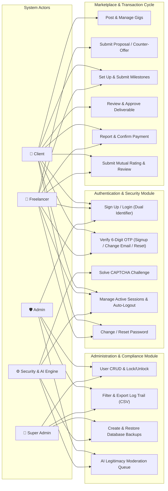
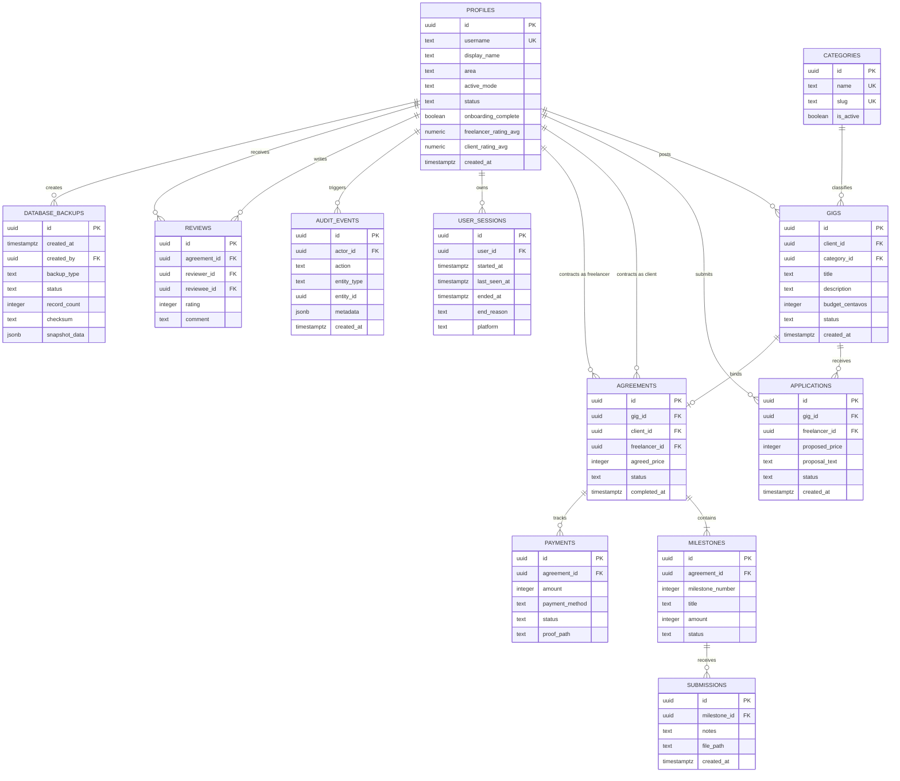
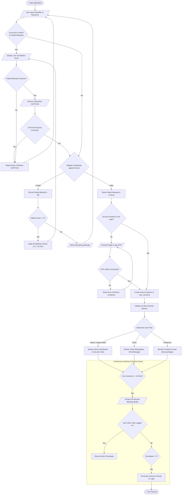
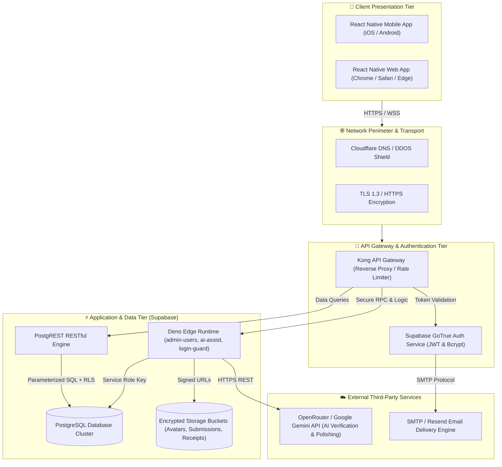

# System Integration and Architecture (SIA) — Final Project Diagrams
**System Title:** Gigormoc (Hyperlocal Gig Marketplace with Security, Moderation, & AI Assistance)  
**Course:** IT/CS — System Integration and Architecture  
**Student:** John Denver Lias (#65)  

This document presents the complete architectural specifications and 5 formal system diagrams complying with the SIA Final Project Requirements.

---

## 1. Use Case Diagram (System Users)

The Use Case Diagram defines the interactions between the system actors and core business & security functionalities.

### System Actors:
* **Client (Primary Actor):** Posts gigs, reviews applicant proposals, creates and manages milestone contracts, reviews work deliverables, confirms payments, and rates freelancers.
* **Freelancer (Primary Actor):** Browses gigs, manages skill portfolio, submits proposals/counter-offers, submits milestone proof-of-work, and rates clients.
* **Admin / Moderator (Administrative Actor):** Views dashboard metrics, manages user accounts (activate, suspend, lock, unlock), reviews dispute reports, and inspects immutable audit logs.
* **Super Admin (Administrative Actor):** Assigns admin roles, triggers on-demand database backups, and executes database restores.
* **External AI Service & Security Governor (Secondary/System Actor):** Performs legitimacy scoring, enforces 3-attempt lockouts, manages 15-minute inactivity timers, and automates scheduled database backups.



---

## 2. System Flow Diagram (Swimlanes and Pools)

The System Flow Diagram models the end-to-end transactional lifecycle and participant handoffs across 4 operational swimlanes: **Client**, **Freelancer**, **System / Database**, and **Admin**.

```mermaid
sequenceDiagram
    autonumber
    actor C as Client
    actor F as Freelancer
    participant S as System & Database (Supabase)
    actor A as Admin

    Note over C,S: Phase 1: Authentication & Gig Posting
    C->>S: 1. Sign up / Login (Email/Username + Password)
    S-->>C: 2. Enforce OTP / Lockout / Session Token
    C->>S: 3. Publish Gig (Title, Budget, Milestones, Area)
    S->>S: 4. Record gig & log audit trail

    Note over F,S: Phase 2: Proposal & Agreement
    F->>S: 5. Browse available gigs (own-content excluded)
    F->>S: 6. Submit Proposal / Counter-Offer
    S-->>C: 7. Notify Client of applicant
    C->>S: 8. Accept proposal & create Agreement
    S->>S: 9. Lock status to 'active'; generate Milestone tracking

    Note over F,C: Phase 3: Deliverable & Payment Execution
    F->>S: 10. Submit Deliverable (Private storage bucket)
    S-->>C: 11. Notify Client of submission
    C->>S: 12. Review & Approve Milestone work
    C->>S: 13. Submit Payment Evidence (Reference No., Receipt)
    F->>S: 14. Confirm Payment Receipt
    S->>S: 15. Transition Agreement status to 'completed'

    Note over C,F: Phase 4: Mutual Review & Feedback
    par Client Review
        C->>S: 16. Submit Star Rating & Review for Freelancer
    and Freelancer Review
        F->>S: 17. Submit Star Rating & Review for Client
    end
    S->>S: 18. Recalculate incremental profile ratings

    Note over A,S: Phase 5: Audit & Administration
    A->>S: 19. Inspect tamper-proof Log Trail (Filter/Export CSV)
    A->>S: 20. Trigger manual / scheduled Database Backup
    S-->>A: 21. Confirm cryptographic checksum & snapshot
```

---

## 3. Entity Relationship Diagram (ERD)

The ERD details the relational database structure, primary keys (PK), foreign keys (FK), and entity relationships enforced by PostgreSQL.



---

## 4. System Flowchart

The System Flowchart depicts the operational logic, decision branches, validation gates, and input/output processing of Gigormoc.



---

## 5. Network Diagram (Network Flow)

The Network Diagram details the multi-tier client-server topology, protocols, security boundaries, cloud infrastructure, and external microservices.



---

## 6. Diagram Conformance Checklist

| Requirement | Diagram | Conformance Notes |
|---|---|---|
| **1. Use Case Diagram** | Section 1 | Identifies Client, Freelancer, Admin, Super Admin, and System/AI Engine. Full standard UML relationships. |
| **2. System Flow Diagram** | Section 2 | 4 distinct participants in sequence lanes, complete transaction cycle, explicit start & end. |
| **3. Entity Relationship Diagram (ERD)** | Section 3 | Identifies all core entities, data types, primary keys (PK), foreign keys (FK), and cardinalities. |
| **4. System Flowchart** | Section 4 | Uses standard flowchart symbols (ovals, rectangles, diamonds, parallelograms), inputs, logic branches, and storage elements. |
| **5. Network Diagram** | Section 5 | Shows mobile and web clients, TLS perimeter, API Gateway, Auth, Postgres DB with RLS, Deno Edge Functions, and external AI services. |
